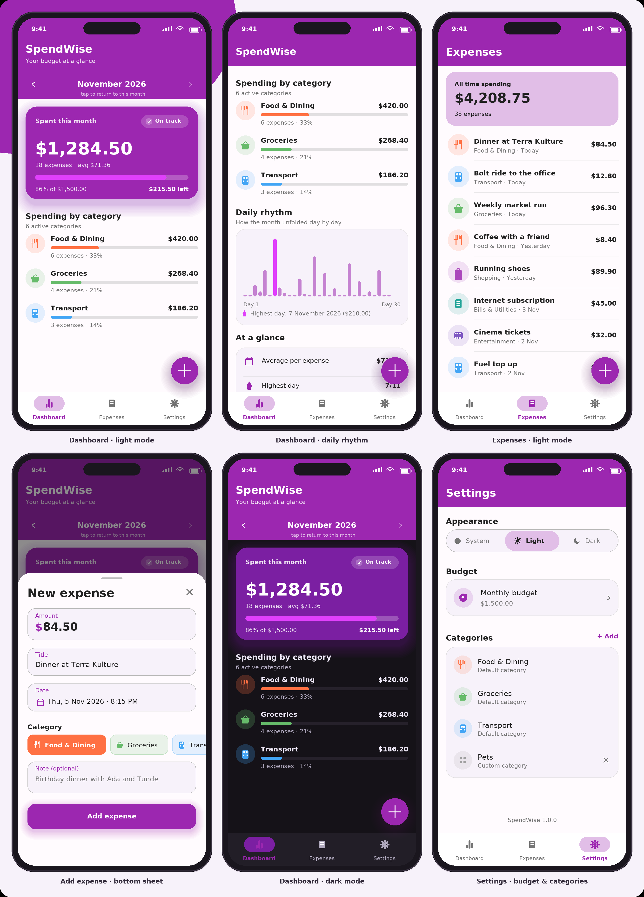

# SpendWise — Personal Budget & Expense Tracker

A complete, offline-first expense tracker built with **Flutter**, **Riverpod 3 (codegen)** and
**Hive CE**, organised with **Clean Architecture**.



---

## 1. Folder structure

```
lib/
├── main.dart                          # Entry point: bootstrap then ProviderScope
├── app/
│   ├── app.dart                       # MaterialApp, theme binding, routes
│   ├── app_routes.dart                # Named routes and argument parsing
│   └── home_shell.dart                # Bottom navigation shell, quick add FAB
│
├── core/
│   ├── constants/
│   │   └── default_categories.dart    # Seeded categories, stable ids and colours
│   ├── error/
│   │   └── failure.dart               # Sealed Failure hierarchy
│   ├── theme/
│   │   ├── app_colors.dart            # The exact brand palette
│   │   ├── app_color_schemes.dart     # Light and dark ColorScheme
│   │   ├── app_typography.dart        # Text theme derived from the palette
│   │   └── app_theme.dart             # Material 3 ThemeData for both modes
│   └── utils/
│       ├── bootstrap.dart             # Hive init, adapters, box opening, seeding
│       ├── category_visuals.dart      # Icon and colour lookups for categories
│       ├── formatters.dart            # Currency, date and percentage formatting
│       ├── result.dart                # Result, Success, Error, helpers
│       └── use_case.dart              # UseCase and StreamUseCase contracts
│
├── shared/
│   └── widgets/
│       ├── empty_state.dart           # Friendly empty placeholder
│       ├── error_view.dart            # Error surface with retry
│       └── section_header.dart        # Title plus supporting line
│
└── features/
    ├── expenses/
    │   ├── domain/                    # Pure Dart, no Flutter or Hive
    │   │   ├── entities/
    │   │   │   ├── category.dart
    │   │   │   └── expense.dart
    │   │   ├── repositories/
    │   │   │   ├── category_repository.dart
    │   │   │   └── expense_repository.dart
    │   │   └── usecases/
    │   │       ├── categories/        # Get, Watch, Add, Delete category
    │   │       └── expenses/          # Get, Watch, Get by id, Get for month,
    │   │                              # Add, Update, Delete expense
    │   ├── data/
    │   │   ├── models/                # HiveType models, adapters, registrar
    │   │   ├── datasources/           # Contracts, Hive implementations, box names
    │   │   └── repositories/          # Repository implementations
    │   └── presentation/
    │       ├── providers/             # Riverpod controllers and generated files
    │       ├── views/                 # Expense list, form sheet, full screen form
    │       └── widgets/               # Tile, avatar, chip selector, amount field
    │
    ├── dashboard/
    │   ├── domain/
    │   │   ├── entities/budget_summary.dart
    │   │   └── usecases/              # GetBudgetSummary, GetCategoryTotals
    │   └── presentation/
    │       ├── providers/             # Dashboard controller, selected month
    │       ├── views/dashboard_page.dart
    │       └── widgets/               # Overview card, breakdown, bar chart, switcher
    │
    └── settings/
        └── presentation/
            ├── providers/             # Settings state and controller
            ├── views/settings_page.dart
            └── widgets/               # Appearance selector, budget and category dialogs
```

**Layer rules**

| Layer | May import | Must never import |
|---|---|---|
| `domain` | `equatable` only | Flutter, Hive, Riverpod |
| `data` | `domain`, `hive_ce`, `core/utils` | Presentation |
| `presentation` | `domain`, `core`, `shared` | `hive_ce` directly |

---

## 2. Design system

| Token | Value |
|---|---|
| Primary | `#9C27B0` |
| Light primary | `#E1BEE7` |
| Dark primary | `#7B1FA2` |
| Secondary / accent | `#E040FB` |
| Primary text | `#212121` |
| Secondary text | `#757575` |
| Divider / border | `#BDBDBD` |
| On-primary text and icons | `#FFFFFF` |

`AppColors` holds those values; `AppColorSchemes` maps them onto Material 3 roles.
Filled brand surfaces (app bar, hero card, FAB) always use Primary, or Dark Primary in dark
mode, so the brand tone stays saturated while body text stays readable.

---

## 3. Feature set

- Add, edit, view and delete expenses — title, amount, date, category and note.
- Full offline persistence with typed Hive boxes and seeded default categories.
- Budget dashboard: month switcher, budget usage, category ranking, daily bar chart, stats.
- Monthly budget, theme mode (system / light / dark) and custom category management.
- Validation lives in the domain layer; every failure reaches the UI as a `Failure`.

---

## 4. Dependencies

| Package | Version | Why this pin |
|---|---|---|
| `flutter_riverpod` / `riverpod_annotation` | 3.2.1 / 4.0.2 | `Notifier`, `AsyncNotifier`, `StreamNotifier` |
| `riverpod_generator` | 4.0.3 | First release on `analyzer ^9` |
| `hive_ce` / `hive_ce_flutter` | 2.22.0 / 2.3.3 | Maintained Hive v2, same `@HiveType` API |
| `hive_ce_generator` | 1.12.0 | Also `analyzer ^9`, so it co-resolves |
| `intl` | 0.20.2 | Currency and date formatting |
| `equatable` | 2.0.7 | Value equality in entities |

Classic `hive_generator` is unmaintained and requires `analyzer <7`, which cannot co-resolve
with any Riverpod generator release. Hive CE keeps the identical annotation API.

---

## 5. Generated files

`*.g.dart` files are committed so the project runs without a codegen step.

```bash
flutter pub get
dart run build_runner build --delete-conflicting-outputs   # optional
flutter run
```

Adapters follow the Hive CE byte protocol; providers follow the Riverpod 3.2.1
`handleCreate` format.

---

## 6. Tests

```bash
flutter test
```

- `test/features/expenses/domain/usecases/` — validation, sorting, filtering, failures.
- `test/features/dashboard/domain/usecases/` — totals, ranking, daily grouping, budget clamping.
- `test/features/expenses/data/models/` — entity mapping and adapter type ids.
- `test/core/theme/` — palette and `ThemeData` assertions.
- `test/widget_test.dart` — widget smoke test.

---

## 7. Screenshots

The images in `docs/screenshots/` were rendered from the widget source by
`docs/screenshots/render_previews.py` — every colour, string and measurement is taken from
`lib/`. They are design previews, not emulator captures.

| File | Screen |
|---|---|
| `01-dashboard-light.png` | Dashboard, light mode |
| `02-dashboard-scrolled.png` | Daily rhythm chart and stats |
| `03-expenses-light.png` | Expense list |
| `04-add-expense.png` | Add expense bottom sheet |
| `05-dashboard-dark.png` | Dashboard, dark mode |
| `06-settings.png` | Settings, budget and categories |

Regenerate with:

```bash
python3 docs/screenshots/render_previews.py   # requires Pillow
```
